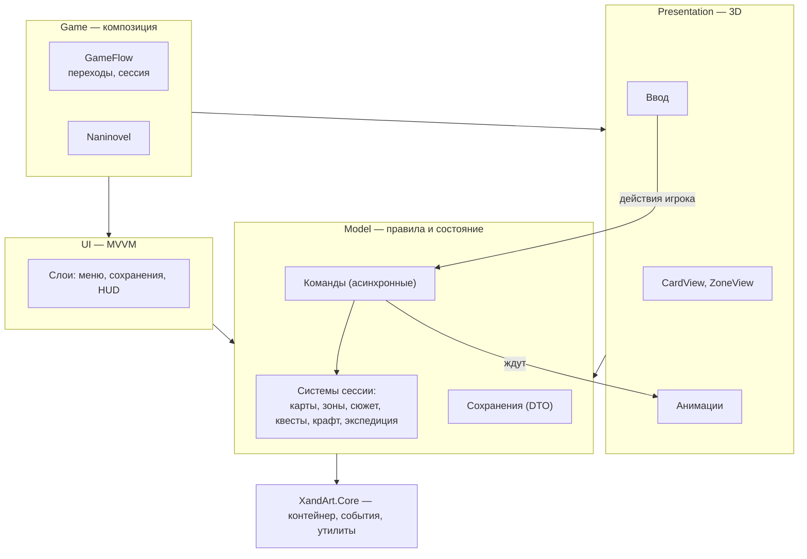

[[Главная]] / [[Техническая документация]]

> [!info] Статус
> Архитектура согласована в обсуждении 2026-10-10. Код прототипа устроен иначе и будет
> переписан по этой схеме. Задачи — в [[tasks|трекере]], эпики помечены `kind: epic`.

## Зачем проекту архитектура

Архитектура нужна, чтобы проект мог жить: она сдерживает рост технического долга, организует
взаимодействие частей проекта и даёт управлять проектом в целом.

![[bug-hunting.png]]

Технический долг — это то, сколько дополнительного времени уходит на каждую следующую задачу.
По мере роста проекта в нём становится всё больше элементов и связей между ними, и рост
сложности ускоряется. Архитектура вводит порядок: элементы группируются по смыслу, а пути
взаимодействия между группами явно прописаны.

![[modules-grouping.png]]

*Делим по смыслу, цвету, форме.*

Для TheGrowth это особенно важно: прототип писался урывками, и в нём состояние игры, логика и
отображение перемешаны. Итог — баги, которые проявляются только в конкретных сценариях
(загрузка, переход между локациями), и страх что-либо трогать.

## Общая картина

Ключевые идеи:

1. **Модель не знает о сцене.** Правила игры, состояние и скрипты работают без Unity-сцены
   (анимации — через интерфейсы). Это даёт автоматические тесты.
2. **Команды асинхронные, игра пошаговая.** Команда ждёт завершения действия, каждый скрипт
   завершается, сохраняемся только когда скриптов нет.
3. **Карта всегда ровно в одном месте.** Инвентари заменены колодами и зонами.
4. **Один путь создания игры.** Новая игра и загрузка сохранения создают сессию одинаково.
5. **Состояние и сохранение разделены.** Игровые классы не знают о формате сейва; сейв — отдельные
   простые структуры с версией.

## Дочерние страницы

- [[Жизненный цикл игры]] — старт, загрузка, переходы между локациями, точки сохранения.
- [[Данные и сохранения]] — конфиги и ID, системы, формат и слоты сохранений.
- [[Карты и зоны]] — устройство карты, колоды и зоны, экспедиция.
- [[Логика и отображение]] — как разрешается ход и как проигрываются анимации.
- [[Скрипты]] — команды, кондишены, эвалуаторы.
- [[Интерфейс (MVVM)]] — устройство UI.
- [[Структура кода]] — сборки, папки, зависимости, тесты.
