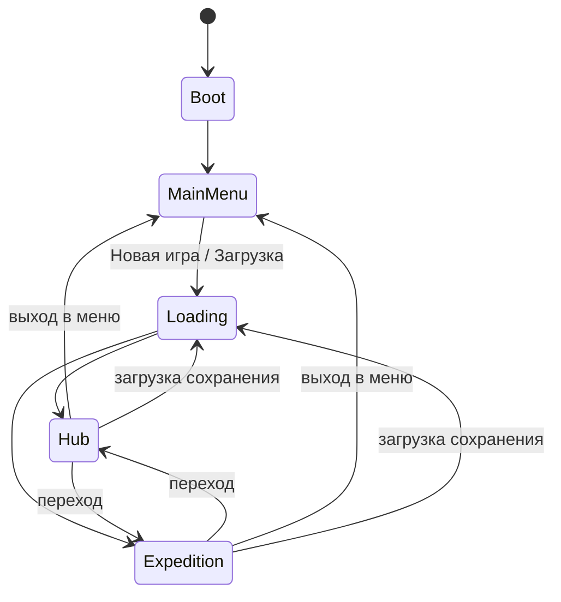

[[Главная]] / [[Техническая документация]] / [[Архитектура проекта]]

## Состояния игры

Поверх хаба и экспедиции может быть открыт диалог или пауза — это режимы, а не
отдельные состояния.

## GameFlow — единственный, кто управляет переходами

- Только `GameFlow` загружает и выгружает сцены, создаёт и уничтожает сессию.
- Команды и кнопки не выполняют переход сами — они отправляют запрос («перейти в экспедицию X»,
  «загрузить слот Y», «выйти в меню»).
- Запросы выполняются строго по одному. Пока идёт переход, ввод заблокирован и показан экран
  загрузки.

## Области жизни (scopes)

| Область | Сколько живёт | Что внутри |
|---|---|---|
| Global | всё время работы игры | GameFlow, сохранения (файлы, слоты), настройки, звук, корень UI, ввод |
| Session | от «Новая игра»/«Загрузить» до выхода в меню | все системы игры: карты, слоты, сюжет, квесты, крафт, экспедиция |
| Location | пока загружена сцена локации | вьюхи карт и слотов этой сцены, управление картами, камера |

Всё, что принадлежит области, уничтожается вместе с ней — подписки, анимации, асинхронные
операции. Глобальных статических переменных с игровым состоянием нет.

## Новая игра и загрузка — один путь

- **Новая игра** = создать сессию из пустого сохранения + запустить стартовый шаг сюжета.
- **Загрузка** = создать сессию из сохранения со слота.

Сессия создаётся одним и тем же кодом, отличается только источник данных. Поэтому ситуация
«в новой игре работает, после загрузки — нет» исключена конструкцией.

## Когда можно сохраняться

Сохранение разрешено, когда:
- не идёт переход между локациями;
- не открыт диалог;
- нет ни одного активного командного скрипта (игра пошаговая — такие моменты есть всегда).

Автосейв — по событиям: вход в хаб, конец хода экспедиции, конец экспедиции, смена шага сюжета.
