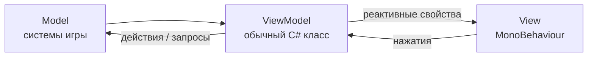

[[Главная]] / [[Техническая документация]] / [[Архитектура проекта]]

## Вижен

Игра полностью трёхмерная, интерфейс минимальный — как в Marvel Snap. Карты, колоды, доска
крафта — объекты на сцене, а не UI. На UI остаются: меню, сохранения, HUD, подсказки, оверлей
диалога, экран загрузки.

## MVVM

- **Model** — системы игры (сюжет, квесты, сохранения, ...).
- **ViewModel** — обычный C# класс: берёт данные из модели и готовит их для показа, принимает
  команды от вьюхи. Владеет своими подписками и освобождает их.
- **View** — компонент на объекте UI: подписывается на свойства ViewModel и обновляет
  картинку. Модель напрямую не меняет.
- Связь в коде, без строковых привязок через рефлексию (как было в GeekyHouse) —
  переименование свойства ловит компилятор.
- Реактивные свойства и коллекции — библиотеки R3 и ObservableCollections.

## Как устроено (решено 2026-10-20)

- Базовые классы MVVM лежат в Architecture — ими могут пользоваться и UI, и 3D.
- Окно существует, пока существует его ViewModel: открыть окно — создать VM, закрыть — уничтожить.
- Каждый слой — отдельный префаб; его создаёт фабрика по типу VM.
- Какие окна открыты, решают наблюдатели: глобальный (меню, загрузка, подтверждения) и
  сессионный (HUD, пауза, сохранение). Сессионный уничтожается вместе с сессией.
- Модальные окна блокируют управление картами.
- uGUI + TextMeshPro, анимации окон — DOTween. Навигация геймпадом закладывается сразу.
- Вьюхи карт — не UI: 3D-объекты, возможно на Spine, с кастомными шейдерами.

## Слои

UI разбит на слои: главное меню, сохранение/загрузка, пауза, HUD, диалог, загрузка, подсказки,
уведомления. Какие слои открыты — определяется состоянием игры (см. [[Жизненный цикл игры]]).
Слои создаёт и переключает `UIManager`.

## Экран сохранений

- Список слотов с превью, датой, шагом сюжета.
- Ручные слоты без ограничения, 3 автосейва.
