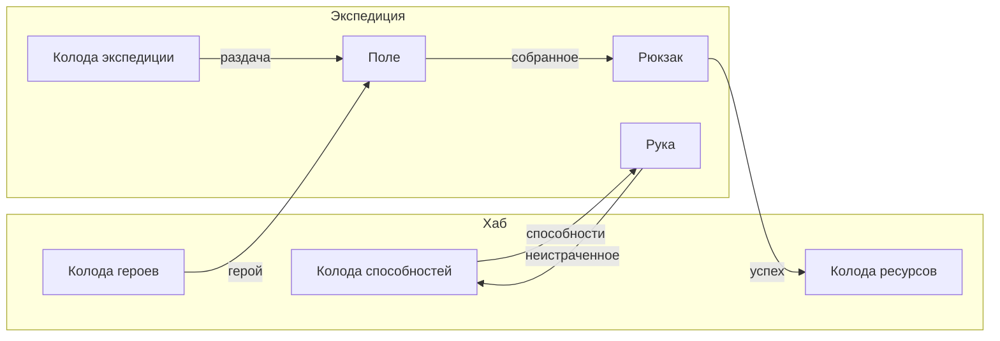

[[Главная]] / [[Техническая документация]] / [[Архитектура проекта]]

## Карта: модель — экземпляр — сохранение

Схема взята из модуля игровых сущностей GeekyHouse.

![[entity-model-instance-save.png]]

- **Модель** (`CardModel`) — конфиг, который делают дизайнеры: визуал, тип, набор настроек
  компонентов, реакции на события (команды).
- **Экземпляр** (`CardInstance`) — конкретная карта в игре: номер, модель, слот, лицом вверх
  или нет, состояние компонентов, именованные переменные (например, заряды).
- **Сохранение** (`CardSave`) — данные экземпляра для записи на диск.

Компоненты устроены так же, тройками: настройка в конфиге → поведение в игре → данные в
сохранении. Пример: настройка «Заряды: 3» → поведение хранит текущее число зарядов → в сейв
пишется число.

- **Логика карты** — в её файле `.script`: реакции на события (хуки) и свойства вроде
  `AllowedMoves -> [slots around [active card] cross 1]`.
- **Теги** вместо групп: у карты список тегов (монстр, ресурс, особая…), в скриптах —
  `[card] has tag monster`.
- **Герой**: персонаж диалогов, карта героя и карты способностей — отдельные конфиги, карта героя
  ссылается на персонажа.

Карта — единственная «сущность» в игре. Сюжет, квесты, крафт — это системы со своими данными,
а не сущности.

## Слоты

**Слот** — место, на которое можно положить одну или несколько карт:

| Где | Слоты |
|---|---|
| Хаб | колода героев, колода способностей, колода ресурсов, сюжетные предметы |
| Крафт | слоты доски крафта |
| Экспедиция | клетки поля, рука, колода экспедиции, сброс, рюкзак |

Правила:
- Карта всегда лежит ровно в одном слоте. Не бывает, чтобы карта была одновременно в двух
  инвентарях.
- Перемещение — одна операция: карта убирается из старого слота и кладётся в новый.
- У слота есть правила: какие карты на него можно положить, сколько, лицом или рубашкой.
- Как карты разложены в слоте (стопка, веер, вдоль кривой) — решает вьюха слота. Вьюха карты
  одна для всех мест.
- Поле экспедиции — набор слотов. Сейчас сетка, от жёсткой сетки планируем отказаться.

## Экспедиция

- Старт: создаются слоты экспедиции, колода экспедиции наполняется по конфигу, герой и
  способности **переносятся** из хаба.
- Конец: при успехе собранное из рюкзака переносится в колоды хаба, неистраченные способности
  возвращаются. При провале — по правилам дизайна.
- Состояние экспедиции сохраняется, сохраниться можно между ходами.

## Ресурсы

Инвентарь — это колода. 15 собранных трав = 15 карт травы в колоде. Стаков нет.
