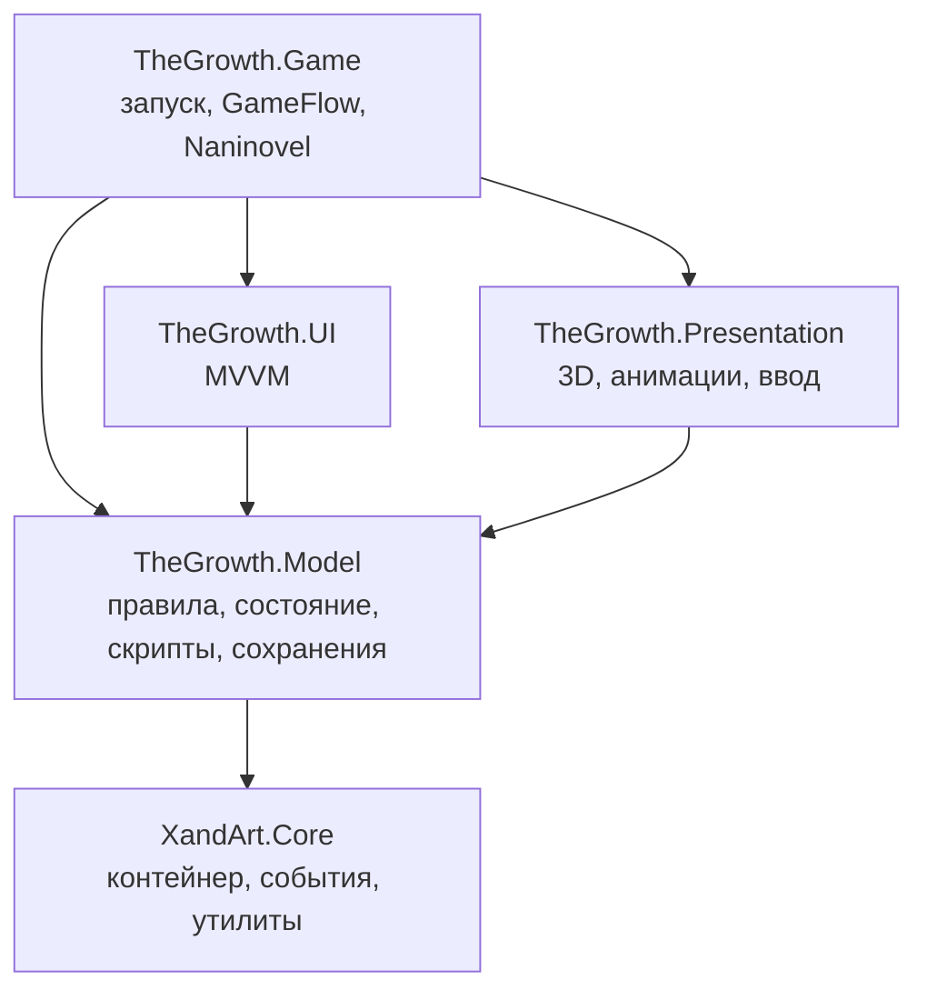

[[Главная]] / [[Техническая документация]] / [[Архитектура проекта]]

## Модульность: что взяли и от чего отказались

В GeekyHouse проект делился на модули-пакеты с группами по уровню абстракции: модули высокого
уровня зависят от низкоуровневых, но не наоборот.

![[modules-pyramid.png]]

Принцип зависимостей «только вниз» сохраняем. Отказываемся от пакетов на каждый модуль: в
TheGrowth одна игра и маленькая команда, переиспользовать модули между проектами не нужно,
а накладные расходы на пакеты заметны.

Решение: **слои — сборками (asmdef), системы — папками.**

## Сборки

Плюс `TheGrowth.Editor` (инструменты редактора) и две сборки тестов (EditMode, PlayMode).

Главное правило: **Model не зависит от сцены, UI, анимаций и Naninovel.** Нужное ей снаружи она
получает через интерфейсы. Это позволяет запускать игровую логику в тестах без Unity-сцены.

## Папки

- Внутри сборки код разложен по системам: `Cards/`, `Zones/`, `Story/`, `Quests/`, `Craft/`,
  `Expedition/`, `Saves/`, `Scripting/`, ...
- Конфиги лежат в `Content/` по типам: `Cards/<Группа>/<Карта>.asset`.
- Конфиги не лежат в `Resources` — доступ через реестр контента.

## Тесты

- Основной вид — тесты логики без сцены: создать сессию, выполнить действия игрока, проверить,
  где лежат карты и что увидит игрок.
- Проверка скриптов: каждая реакция каждой карты запускается на тестовом поле.
- Проверка контента: дубли ID, битые ссылки, пропавшие типы в скриптах.
- Тесты миграций сохранений.
- Немного тестов со сценами: загрузка каждой локации, сохранение и загрузка.
